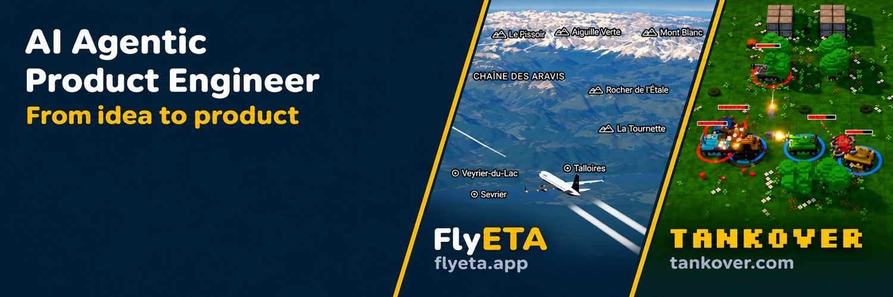

# Nick Bubelich



**AI agentic product engineer, Vienna.** I take products from idea to the app stores, as one person with a fleet of AI coding agents.

The agents write most of the code. I own the product: the few rules decided first, the design, the architecture, the tests and the release. The rules live in one file that every agent reads, and a gate checks them before anything ships.

### Products

**[FlyETA](https://flyeta.app)** - follow your flight from a window seat, offline. A native iPhone app (Swift, SwiftUI, Metal) and a native Android app (Kotlin, Jetpack Compose, Vulkan) over one Rust engine, with a 3D globe of the whole planet that fits in 161 MB inside the app. First commit in August 2026, on the App Store and Google Play on 31 October. Free, with no ads and no account.

**[TankOver](https://tankover.com)** - a voxel toy tank game on a giant desk. A 16-level campaign, online team versus, free-for-all and co-op for up to 32 players. A Rust engine compiled to WebAssembly, a three.js and TypeScript view. In the browser, on the App Store, the Mac App Store and Google Play.

### Open source

- **[rust-openrouter-mcp](https://github.com/thesimj/rust-openrouter-mcp)** - MCP server and CLI for OpenRouter in a single Rust binary. Discover models and generate images, video and speech from Claude. On crates.io.
- **[rust-hetzner-mcp](https://github.com/thesimj/rust-hetzner-mcp)** - a Rust MCP server that manages Hetzner Cloud servers, networks, volumes and firewalls.
- **[envyaml](https://github.com/thesimj/envyaml)** and **[tomlev](https://github.com/thesimj/tomlev)** - Python configuration from YAML and TOML files with environment variables.
- **[ste-eli5](https://github.com/thesimj/ste-eli5)** - a writing style for agents: Simplified Technical English sentences, answer first.

### Also building

**AE Lang / SwarmGentic** - a deterministic DSL, compiler and runtime for multi-agent LLM workflows. Tokenizer, static validator, linter, JSON compiler, and a dependency-aware parallel runner with retries, journaled runs, and per-run evaluation. Reference implementation in TypeScript, second in Python.

**Knowledge Engine** - RAG pipeline over a large Obsidian knowledge base with Qdrant vector search and an agentic retrieval loop built on the Anthropic SDK.

### Before that

18+ years of production software. I started coding at 14.

- Co-built **raicoon's** Autonomous Operations Center for renewable energy. ML anomaly detection across 100+ solar plants and thousands of daily events. Later owned the architecture and hired the engineering team.
- Technical lead on a physical-security platform suite: 180+ sites, 2,000+ cameras, 100 GB+ of video and telemetry a day on a private multi-node S3 cluster. Real-time video analytics and IoT pipelines.
- Founded and ran **Belnet**, an ISP serving 20,000+ households in Odesa, for 17 years. Founded Belichberg in Vienna in 2017.
- Kaggle: top 11% on iMaterialist Furniture (FGVC5), 97.72% ROC on TalkingData fraud detection.

### Stack

```
languages  TypeScript · Python · Rust · Swift · Kotlin
agents     agentic coding workflows · multi-agent orchestration · MCP · RAG
           Anthropic SDK · OpenRouter · embeddings / vector search · LLM evaluation
mobile     SwiftUI · Jetpack Compose · Metal · Vulkan · Capacitor
web        three.js / WebGL · WebAssembly · Astro · Next.js · Svelte · Tailwind
backend    axum · FastAPI · gRPC · WebSockets · Tauri · Electron · PyO3
data       PostgreSQL · SQLite · Qdrant · ClickHouse · Redis · S3
infra      Docker · Kubernetes · Ansible · self-hosted GitLab CI · Hetzner · AWS · Sentry
```

### Elsewhere

[flyeta.app](https://flyeta.app) · [tankover.com](https://tankover.com) · [x.com/nbpatron](https://x.com/nbpatron) · [linkedin.com/in/mykola-bubelich](https://www.linkedin.com/in/mykola-bubelich/) · [bubelich.com](https://bubelich.com)
